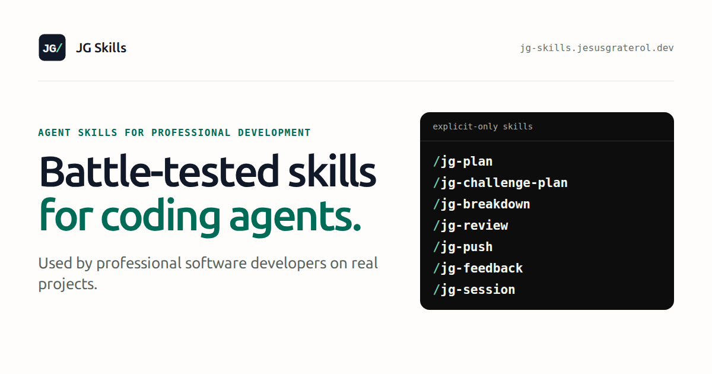

# JG Skills

[](https://jg-skills.jesusgraterol.dev)

Solid, battle-tested Agent Skills for planning, reviewing, and shipping changes with coding agents, used by professional software developers in their daily work. Each skill defines what it may change and defers general engineering standards to the coding instructions of the repository you use it in.

Browse the skills, their full instructions, and an example session at [jg-skills.jesusgraterol.dev](https://jg-skills.jesusgraterol.dev).

## Install

Run this from your repository's root:

```bash
npx skills add jesusgraterol/jg-skills --skill "*" -y
```

The command uses the [skills CLI](https://github.com/vercel-labs/skills) through `npx`, so it needs Node.js. It installs the skills into the project for the coding agents you use there, so you can commit them and share the same workflow with your team.

## Use

Discuss a change with your coding agent, then invoke a skill by name, followed by any text it should take into account:

```text
/jg-plan
```

In Codex, type `$jg-plan` instead.

The current collection contains explicit skills that run only when you invoke them by name. Implicit skills will be added in the future. Each current skill sets `disable-model-invocation: true` in its frontmatter and ships an `agents/openai.yaml` policy that disables implicit invocation. Explicit-only loading is verified with Claude Code and Codex.

## Update and remove

Run these from your repository's root:

```bash
npx skills update -p jg-brainstorm jg-plan jg-challenge-plan jg-breakdown jg-execute jg-debug jg-pause jg-review jg-push jg-feedback jg-session
```

```bash
npx skills remove jg-brainstorm jg-plan jg-challenge-plan jg-breakdown jg-execute jg-debug jg-pause jg-review jg-push jg-feedback jg-session
```

Both commands name the skills, so other skills in the project are left alone.

## Skills

| Skill               | What it does                                                                                  | What it may change                                                                                     |
| ------------------- | --------------------------------------------------------------------------------------------- | ------------------------------------------------------------------------------------------------------ |
| `jg-brainstorm`     | Thinks an idea through with you and recommends a direction before planning.                   | Nothing.                                                                                               |
| `jg-plan`           | Settles your decisions with you, then creates or revises an implementation-ready plan.        | Writes `plan.md` under `coding-agent-planning/`; removes a stale `milestones.md`.                      |
| `jg-challenge-plan` | Challenges a plan before approval and surfaces material risks, gaps, and decisions.           | Nothing.                                                                                               |
| `jg-breakdown`      | Splits a plan into ordered, reviewable milestones when it has real implementation boundaries. | Writes or removes `milestones.md` next to the plan.                                                    |
| `jg-execute`        | Builds an agreed task, a plan, or its milestones; supervised by default, or `autonomous`.     | Code and milestone status lines. In autonomous mode it also commits and pushes each milestone's files. |
| `jg-debug`          | Reproduces a bug, finds its cause, and fixes it with a regression test that fails first.      | Code, a regression test, and temporary logging it removes. Never commits.                              |
| `jg-pause`          | Stops at the nearest safe point, reports where things stand, and waits until you continue.    | Nothing.                                                                                               |
| `jg-review`         | Reviews the task's changes and how they follow its plan, or the branch against a target.      | No files. With a target branch, it may refresh that branch's remote-tracking ref.                      |
| `jg-push`           | Commits the current task's files with a signed-off, signed commit and pushes the branch.      | Stages and commits the task's files (or every change without a task) and pushes the current branch.    |
| `jg-feedback`       | Assesses feedback independently and recommends what to adopt, reject, or adjust.              | Nothing.                                                                                               |
| `jg-session`        | Finds a named Codex or Claude Code session and answers questions about it.                    | Nothing.                                                                                               |

## A typical run

1. `jg-brainstorm` thinks the idea through with you and ends with a summary you can plan from.
2. `jg-plan` asks about any decision that is yours to make, then turns the discussion into a plan under `coding-agent-planning/` and asks for approval. When the idea isn't clear enough to plan, it points you back to `jg-brainstorm`.
3. Optionally, `jg-challenge-plan` returns a verdict, any required corrections, and numbered decisions, and `jg-plan` with your answers revises the same plan.
4. Optionally, `jg-breakdown` writes `milestones.md` when the plan has real milestone boundaries, with a status line under each milestone: pending, in progress, or done.
5. `jg-execute` builds the next milestone, runs its checks, and stops so you can run `jg-review` and `jg-push` yourself. `jg-review` checks the change against the plan and the milestone it belongs to, as well as the code. `jg-execute autonomous` builds every remaining milestone instead, reviewing and pushing each one before starting the next.

Use `jg-pause` at any point to stop the agent at a safe point and pick up later. Use `jg-debug` when something breaks and the cause isn't obvious.

## Website

The site in `website/` is a static Astro and Tailwind CSS project. It reads every `skills/*/SKILL.md` at build time, so the published names, descriptions, and instructions always match what gets installed.

Requirements: Node.js `24.15` or newer within Node 24, and npm `11.12` or newer within npm 11. Run these from `website/`:

```bash
npm ci
npx playwright install chromium
npm run dev
```

| Command                   | Purpose                                                                                             |
| ------------------------- | --------------------------------------------------------------------------------------------------- |
| `npm run dev`             | Start the Astro development server. If an edit under `skills/` does not appear, restart it.         |
| `npm run build`           | Generate the site in `dist/` and verify every skill page, metadata, link, and `llms.txt`.           |
| `npm run preview`         | Serve the current production build locally.                                                         |
| `npm run check`           | Run unit tests, typechecking, linting, formatting, the build, integration tests, and browser tests. |
| `npm test`                | Run the unit, integration, and end-to-end test categories.                                          |
| `npm run format`          | Format the website files.                                                                           |
| `npm run assets:generate` | Regenerate the committed open-graph image from its HTML template.                                   |

The build fails when the site catalog in `website/src/site.config.ts` and the skill folders disagree, when a skill name differs from its directory, when a skill does not ship the explicit-only Codex policy, or when a skill's search title or description would be cut off in search results. When you add a skill, add its catalog entry with an example invocation, a search title of at most 60 characters that starts with the skill name, a search description of 70 to 160 characters, and a short note on when to use it.

### Deployment

`.github/workflows/pages.yml` verifies every pull request and deploys `main` to GitHub Pages. The site expects to be served at the root of `https://jg-skills.jesusgraterol.dev`, so before the first deployment:

1. Set the repository's GitHub Pages source to GitHub Actions.
2. Add the custom domain `jg-skills.jesusgraterol.dev`.
3. Create a DNS `CNAME` record pointing `jg-skills.jesusgraterol.dev` to `jesusgraterol.github.io`.

Until then, the deploy job fails, or the site is served under a path where its root-relative links and assets break.

## Project blueprint

```text
.
├── .github/workflows/       # site verification and GitHub Pages deployment
├── docs/                    # concise, durable project concepts and processes
├── skills/
│   └── jg-<name>/
│       ├── SKILL.md         # frontmatter and the skill's instructions
│       └── agents/
│           └── openai.yaml  # Codex invocation policy
├── website/
│   ├── public/              # favicon, Claude Code mark, robots.txt, and the generated open-graph image
│   ├── scripts/             # open-graph generation and build-artifact verification
│   ├── src/
│   │   ├── components/      # focused Astro presentation modules
│   │   ├── content/         # SKILL.md frontmatter schema
│   │   ├── layouts/         # shared metadata, navigation, theme, and footer shell
│   │   ├── pages/           # home, one page per skill, 404, and llms.txt
│   │   ├── styles/          # Tailwind entry point and branded semantic tokens
│   │   ├── utilities/       # skill catalog loading, SEO, theme, and llms.txt behavior
│   │   └── site.config.ts   # site metadata, commands, and the skill catalog
│   └── vitest/              # test-category discovery configuration
├── LICENSE
└── README.md
```

- Every skill directory name matches the `name` in its `SKILL.md` frontmatter.
- The current skills are explicit-only in both agents: their frontmatter sets `disable-model-invocation: true`, and their `agents/openai.yaml` sets `policy.allow_implicit_invocation: false`. Keep both when adding an explicit skill.
- Every skill is self-contained. Its `## Invocation` section holds the rules all skills share, and it never links to sections of a specific `AGENTS.md`. Skills refer to each other by bare name, such as `jg-breakdown`, never with a `/` or `$` prefix. Every skill works on its own: a mention of another skill is only a pointer, and the one runtime dependency is `jg-execute autonomous`, which reads the `jg-review` and `jg-push` `SKILL.md` files from the neighboring folders.
- Website links show where they lead: `ArrowDown` for a section on the same page, `ArrowRight` (or `ArrowLeft` going back) for another page on the site, and the `external-link` component, which adds a screen-reader note plus an inline new-tab icon, or an up-right arrow in the corner when the link covers a whole card, for other sites.
- The website shares its design tokens, Ubuntu Sans typography, and tooling with Agentic Coding and jesusgraterol.dev. [`docs/asset-attribution.md`](docs/asset-attribution.md) records where its brand marks come from.
- Local coding instructions (`AGENTS.md`, `CANDIDATE.md`) and `coding-agent-planning/` are git-ignored and never published.
- `/docs` is reserved for concise, quickly scannable documentation of essential, durable project concepts and processes. API and HTTP endpoint documentation, if the project ever needs it, belongs outside `/docs`.

## Credits

A few ideas in these skills are adapted from other open-source skill collections and rewritten in our own words:

- [superpowers](https://github.com/obra/superpowers) by Jesse Vincent (MIT): fixing only blocking review findings, checking acceptance criteria before calling work done, a three-attempt stop rule, reporting the decisions an agent made, and a plan self-check.
- [agent-skills](https://github.com/addyosmani/agent-skills) by Addy Osmani (MIT): labeling findings by severity, and listing what was noticed but left alone.
- [pstack](https://github.com/poteto/plugins/tree/main/pstack) by Lauren Tan (MIT): proving a change works on the real path, never weakening a check to get it through, and checking for the same pattern after a fix.
- [skills](https://github.com/mattpocock/skills) by Matt Pocock (MIT): milestones that fit one context window, batched questions with recommended answers, and the debugging loop behind `jg-debug`.

## License

[MIT](LICENSE)
